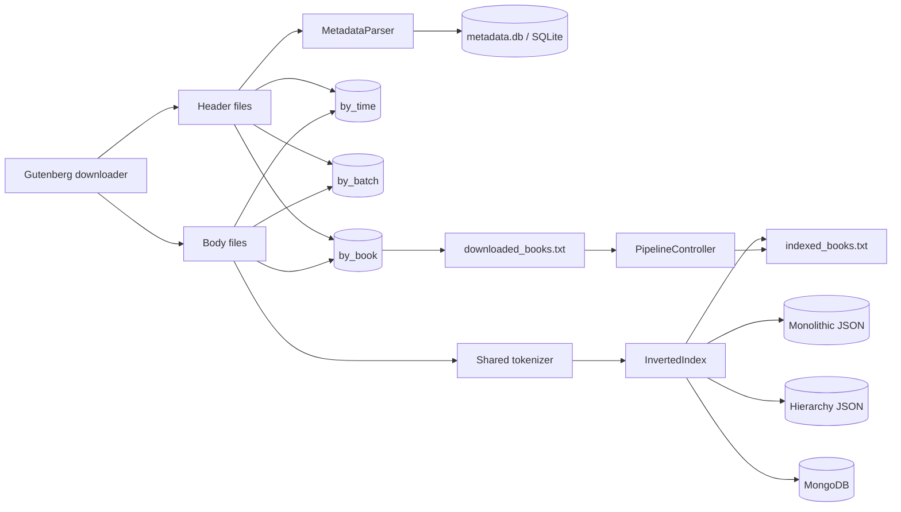

# Stage 1 pipeline

`downloaded_books.txt` is updated after Header/Body creation. The indexing
control file is updated only after every configured storage returns successfully.
The benchmark write region excludes Gutenberg network download, so disk results
are not mislabeled network or generic-operation throughput.
